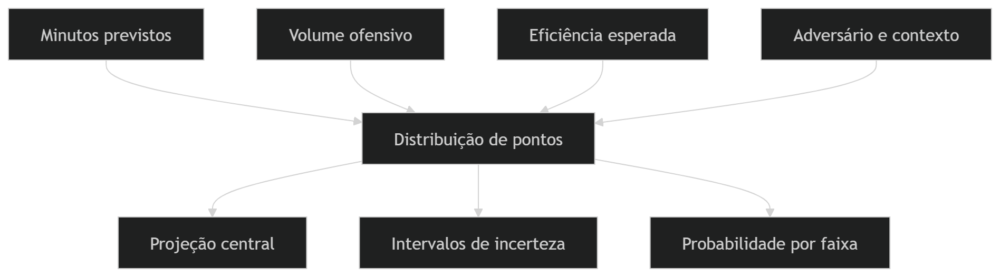

# NBA Analytics Lab

Aplicação em Python (Streamlit) para analisar jogadores e times da NBA, projetar jogos do dia e
acompanhar a qualidade das próprias previsões ao longo da temporada.

> **Importante:** este projeto **não prevê o prêmio de MVP da NBA**. O nome do repositório
> (`NBA_MVP`) é histórico. O foco são projeções de pontos, rebotes e assistências de jogadores,
> probabilidade de vitória e placar de times, sempre com avaliação contra os resultados reais.
> As probabilidades são experimentais e não são recomendação de aposta.

## O que o projeto faz

- **Times:** probabilidade de vitória e placar projetado, com força dos times por Elo
  (com margem de vitória e regressão à média entre temporadas) e modelo Ridge de margem e total
  de pontos. Detalhes em [docs/MODELO_TIMES_ELO.md](docs/MODELO_TIMES_ELO.md).
- **Jogadores:** projeção de PTS, REB e AST por jogo, com intervalos de incerteza, eficiência
  (TS%, eFG%, USG%), mapa de arremessos por zona, defesa e marcações.
- **Jogos e palpites do dia:** capturas pré-jogo preservadas com horário, versão do modelo e
  hash SHA-256, comparadas depois com o resultado real (página **Histórico diário**).
- **Qualidade dos modelos:** validação cronológica, calibração e auditoria dos erros.
- **Atualização diária:** coleta os jogos finalizados do dia anterior e os jogos novos
  ([docs/ATUALIZACAO_DIARIA.md](docs/ATUALIZACAO_DIARIA.md)).



## Requisitos

- Python 3.12
- Acesso à internet para coletar dados via `nba_api`
- Windows, Linux ou macOS (os atalhos `.bat` em `windows/` são só para Windows; no resto, use o `Makefile`)

## Instalação e execução

**Linux e macOS** (com `make` e Python 3.12):

```bash
make install    # cria o .venv e instala requirements-dev.txt
make run        # abre o app em http://localhost:8501
```

Sem `make`, os mesmos passos manuais:

```bash
python3 -m venv .venv
source .venv/bin/activate
pip install -r requirements.txt     # use requirements-dev.txt para testes, lint e tipos
python -m streamlit run app.py
```

**Windows:** `windows\INSTALAR_DEPENDENCIAS.bat` instala as dependências e
`windows\INICIAR_PROJETO.bat` abre o app. Manualmente: crie o ambiente com
`python -m venv .venv`, ative com `.venv\Scripts\activate` e rode os mesmos comandos pip e streamlit.

Na primeira execução não há dados reais: colete-os pela página **Dados e atualizações**
ou com os scripts abaixo.

## Dados e scripts principais

Os dados ficam em `data/` (banco SQLite `data/nba.db`, que **não** é versionado).

| Script | Função |
|---|---|
| `python scripts/sync_current_season.py` | Sincroniza a temporada atual |
| `python scripts/update_daily.py` | Atualização diária (jogos de ontem e de hoje); `make update-data` |
| `python scripts/collect_history.py` | Coleta de histórico de temporadas |
| `python scripts/retrain_models.py` | Retreina os modelos; `make retrain` |
| `python scripts/audit_models.py` | Auditoria de modelos contra jogos ainda não vistos |

## Testes e qualidade

```bash
make test        # pytest
make lint        # ruff
make typecheck   # mypy
make check       # os três, como no CI
```

Sem `make`: `python -m ruff check .`, `python -m mypy src pages app.py desktop_launcher.py scripts`
e `python -m pytest -q`. No Windows, `windows\EXECUTAR_TESTES.bat` roda os testes.

O workflow `tests.yml` roda os mesmos comandos no GitHub Actions.

## Versão online

O app pode ser publicado de graça no Streamlit Community Cloud em **modo somente leitura**
(`NBA_DEPLOY_MODE=cloud`): o GitHub Actions coleta os dados e publica um pacote no Release
`data-latest`, e o app só o baixa. Sem a variável, o programa local e o executável do Windows
funcionam como sempre. Passo a passo em [docs/PUBLICACAO_STREAMLIT.md](docs/PUBLICACAO_STREAMLIT.md);
fontes a revisar em [docs/TERMOS_DE_USO_DAS_FONTES.md](docs/TERMOS_DE_USO_DAS_FONTES.md).

## Documentação

- [Guia detalhado](docs/GUIA_DETALHADO.md): funcionalidades, páginas e funcionamento interno.
- [Histórico de mudanças](CHANGELOG.md): versões e correções.
- [docs/](docs/): documentos técnicos de cada modelo e processo.
- [Executável para Windows](docs/EXECUTAVEL_WINDOWS.md): geração e uso do pacote `.exe`.
- [Plano de melhorias](PLANO_DE_MELHORIAS.md): tarefas de organização e qualidade.
- [Arquitetura de publicação gratuita](ARQUITETURA_PUBLICACAO_GRATUITA.md): app online, pacote de dados e checklist.

## Aviso

Dados e previsões têm fins de estudo. Os modelos erram, e a qualidade medida em jogos passados
não garante desempenho futuro.
