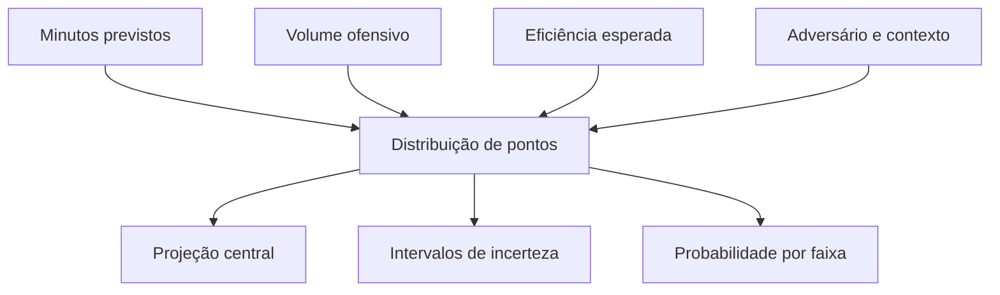

# Análise Estatística de Faixas de Desempenho de Jogadores da NBA

**Projeto:** NBA Analytics Lab  
**Objetivo:** compreender como modelos esportivos estimam distribuições de desempenho e aplicar esses conceitos ao projeto de ciência de dados.

> Este documento trata exclusivamente de análise estatística esportiva. Não contém instruções para apostar, acessar casas de apostas ou utilizar serviços de jogos de azar.

---

## 1. Conceito principal

Uma análise profissional não tenta prever apenas um número exato de pontos. Ela estima uma distribuição de resultados possíveis para o jogador.

Exemplo de apresentação analítica:

```text
Projeção central: 25,4 pontos
Faixa mais concentrada: 22–29 pontos
Faixa ampliada: 18–33 pontos
Incerteza: média
```

A projeção central representa uma estimativa. Os intervalos mostram que diferentes resultados continuam possíveis.

---

## 2. Previsão de minutos

Os minutos costumam ser uma das variáveis mais importantes.

O modelo deverá analisar:

- Titular ou reserva;
- Média recente de minutos;
- Rotação do treinador;
- Lesões e ausências no elenco;
- Possível restrição de minutos;
- Faltas recentes;
- Sequência de partidas;
- Contexto esperado do jogo.

Um atleta com alta produção por minuto pode ter resultados muito diferentes dependendo de jogar 26 ou 36 minutos.

---

## 3. Função ofensiva

O modelo deverá analisar:

- Usage Rate;
- Arremessos tentados;
- Tentativas de três pontos;
- Tentativas de lances livres;
- Tempo de posse de bola;
- Participação nas jogadas;
- Desempenho com ou sem determinados companheiros;
- Mudança de função após troca de time.

Quando um jogador importante não atua, outros atletas podem receber mais minutos e oportunidades ofensivas.

---

## 4. Forma recente com peso temporal

Os jogos recentes deverão receber maior importância, sem apagar o histórico completo.

Segmentos úteis:

- Últimos 5 jogos;
- Últimos 10 jogos;
- Últimos 20 jogos;
- Temporada atual;
- Passagem pelo time atual;
- Temporadas anteriores;
- Histórico da carreira.

Uma média móvel exponencial pode reduzir gradualmente o peso dos jogos antigos:

\[
Peso = e^{-\lambda \times JogosPassados}
\]

Isso evita reagir exageradamente a uma sequência curta de partidas excepcionais.

---

## 5. Adversário e ritmo

Fatores relevantes:

- Pace dos dois times;
- Número esperado de posses;
- Eficiência defensiva;
- Defesa no perímetro;
- Defesa no garrafão;
- Rebotes permitidos;
- Provável marcador;
- Desempenho permitido por posição;
- Estilo do confronto.

Mais posses normalmente significam mais oportunidades estatísticas, mas o efeito deverá ser medido historicamente.

---

## 6. Contexto da partida

Também deverão ser considerados:

- Casa ou fora;
- Dias de descanso;
- Jogos consecutivos;
- Viagens;
- Escalação provável;
- Mudanças de time;
- Função no elenco;
- Fase da temporada;
- Disponibilidade dos principais companheiros.

---

## 7. Distribuição de resultados

Depois de prever minutos, volume e eficiência, o sistema poderá estimar milhares de cenários.



Saídas recomendadas:

- Projeção central;
- Mediana;
- Intervalo de 50%;
- Intervalo de 80%;
- Probabilidade por faixa;
- Grau de confiança;
- Principais fatores;
- Quantidade de jogos usados.

---

## 8. Probabilidades por faixa

Em vez de classificar o desempenho apenas como acima ou abaixo de um único número, nosso projeto deverá mostrar a distribuição completa.

Exemplo:

```text
Até 19 pontos
20–24 pontos
25–29 pontos
30–34 pontos
35 ou mais pontos
```

Esse formato permite avaliar:

- Onde a distribuição está concentrada;
- Quanto o jogador varia;
- Qual é o risco de resultados extremos;
- Se o modelo está muito confiante;
- Como o contexto altera a distribuição.

---

## 9. Diferença entre projeção estatística e linha comercial

Uma projeção estatística busca estimar o desempenho provável do jogador.

Uma linha comercial pode considerar outros elementos operacionais, além da previsão esportiva, como:

- Margem da empresa;
- Novas informações;
- Volume de interesse em cada lado;
- Gestão de exposição;
- Reações do mercado;
- Atualizações de escalação.

Por isso, uma linha comercial não deverá ser usada como verdade estatística ou como rótulo de desempenho.

---

## 10. Aplicação no NBA Analytics Lab

O projeto deverá produzir análises esportivas próprias:

- Pontuação central prevista;
- Minutos previstos;
- Intervalo de pontuação;
- Faixas de desempenho;
- Forma recente;
- Evolução na temporada;
- Mudanças após troca de time;
- Efeito do adversário;
- Fatores do modelo;
- Histórico de previsões e erros.

O sistema não deverá incluir:

- Cadastro em casas de apostas;
- Links para serviços de apostas;
- Valores financeiros;
- Recomendações de apostas;
- Estratégias para apostar;
- Controle de banca;
- Instruções para acessar serviços restritos por idade.

---

## 11. Dados necessários

### Jogador

- Minutos;
- Pontos;
- FGA;
- FG3A;
- FTA;
- Usage Rate;
- Titularidade;
- Time;
- Passagem atual;
- Últimos jogos;
- Eficiência.

### Time

- Pace;
- Eficiência ofensiva;
- Eficiência defensiva;
- Escalação;
- Ausências;
- Distribuição de arremessos.

### Adversário

- Pace;
- Pontos permitidos;
- Defesa por região da quadra;
- Defesa por posição;
- Rebotes permitidos;
- Faltas cometidas;
- Confrontos anteriores.

### Contexto

- Local;
- Descanso;
- Jogos consecutivos;
- Data;
- Temporada;
- Fase da competição.

---

## 12. Processo recomendado

1. Prever os minutos;
2. Prever o volume ofensivo;
3. Prever a eficiência;
4. Gerar a pontuação central;
5. Calcular intervalos;
6. Gerar faixas de desempenho;
7. Explicar os fatores;
8. Registrar a previsão antes do jogo;
9. Comparar com o resultado;
10. Recalibrar o modelo.

---

## 13. Validação

O modelo deverá ser comparado com referências simples:

- Média da temporada;
- Média dos últimos 5 jogos;
- Média dos últimos 10 jogos;
- Média no time atual.

Métricas:

- MAE;
- RMSE;
- Erro médio de minutos;
- Cobertura dos intervalos;
- Calibração das faixas;
- Erro por jogador;
- Erro após mudanças de time;
- Erro por nível de confiança.

---

## 14. Proteção contra vazamento

Somente informações disponíveis antes da partida poderão ser usadas.

Não poderão entrar:

- Pontos da própria partida prevista;
- Minutos da própria partida prevista;
- Médias que incluam o jogo-alvo;
- Escalações publicadas depois da previsão;
- Informações futuras da temporada.

As médias móveis deverão utilizar `shift(1)` ou processamento sequencial equivalente.

---

## 15. Resultado esperado

O projeto deverá responder:

```text
Quantos minutos o jogador provavelmente atuará?
Qual é sua pontuação central projetada?
Qual é a faixa mais provável?
Qual é a amplitude da incerteza?
Quais fatores mais influenciaram a estimativa?
Como o modelo vem se comportando historicamente?
```

O foco será compreender a distribuição de desempenho e melhorar a qualidade das previsões esportivas.
