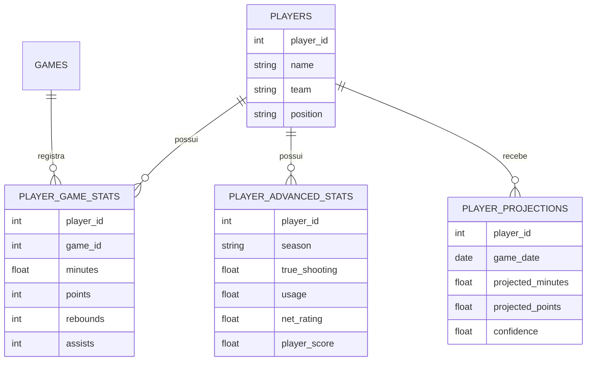

# Módulo de Sabermetria para Jogadores da NBA

**Projeto:** NBA Analytics Lab  
**Objetivo:** analisar individualmente os jogadores da NBA por produção, eficiência, impacto coletivo, defesa, regularidade e contexto, indo além de pontos, rebotes e assistências.

> No basquete, os termos mais utilizados são **basketball analytics** e **estatísticas avançadas**. As análises e projeções representam estimativas esportivas, não certezas.

---

## 1. Objetivo do módulo

Para cada jogador, o programa deverá responder:

- Quanto ele produz?
- Quão eficiente é essa produção?
- Quanto participa do ataque?
- Quanto melhora ou piora o time em quadra?
- Qual é sua contribuição defensiva?
- É consistente ou muito irregular?
- Como atua contra diferentes adversários?
- Como rende em casa, fora, como titular ou reserva?
- Qual desempenho podemos projetar para o próximo jogo?

### Exemplo de apresentação

```text
Jogador: Nikola Jokić
Função estimada: Criador principal / pivô

Pontuação geral: 94/100
Ataque: 97
Criação: 96
Eficiência: 95
Rebotes: 91
Defesa: 78
Impacto coletivo: 96
Consistência: 92

Projeção do próximo jogo:
Minutos: 35
Pontos: 26,8
Rebotes: 11,4
Assistências: 9,2
Confiança: média
```

Os valores acima são apenas um exemplo da apresentação e não representam estatísticas atuais.

---

## 2. Camadas da análise

### 2.1. Estatísticas tradicionais

- Jogos;
- Minutos;
- Pontos;
- Rebotes ofensivos e defensivos;
- Assistências;
- Roubos;
- Bloqueios;
- Turnovers;
- Faltas;
- Arremessos convertidos e tentados;
- Bolas de três;
- Lances livres.

Esses indicadores mostram volume, mas ainda não explicam completamente a eficiência e o impacto do jogador.

### 2.2. Produção por tempo

Para comparar jogadores com minutagens diferentes, serão calculados:

- Pontos por 36 minutos;
- Rebotes por 36 minutos;
- Assistências por 36 minutos;
- Roubos por 36 minutos;
- Bloqueios por 36 minutos;
- Turnovers por 36 minutos.

Fórmula geral:

[
Estatística_{36} = \frac{Estatística}{Minutos} \times 36
]

Também serão calculadas estatísticas por 100 posses, evitando que times com ritmos diferentes prejudiquem a comparação.

### 2.3. Eficiência ofensiva

| Indicador | O que mede |
|---|---|
| TS% | Eficiência considerando arremessos de 2, 3 e lances livres |
| eFG% | Ajusta o aproveitamento pelo valor maior da bola de três |
| USG% | Participação do jogador nas posses ofensivas |
| AST% | Participação nas cestas dos companheiros |
| AST/TO | Assistências produzidas por turnover |
| TOV% | Percentual de posses terminadas em turnover |
| ORtg | Pontos do time por 100 posses enquanto o jogador está em quadra |

#### True Shooting Percentage

[
TS\% = \frac{PTS}{2 \times (FGA + 0,44 \times FTA)}
]

O TS% considera o valor dos arremessos de três e dos lances livres.

#### Effective Field Goal Percentage

[
eFG\% = \frac{FGM + 0,5 \times 3PM}{FGA}
]

O eFG% ajusta o aproveitamento porque uma bola de três vale mais que uma bola de dois.

### 2.4. Impacto coletivo

Será analisado o comportamento do time:

- Com o jogador em quadra;
- Com o jogador fora;
- Ao lado de determinados companheiros;
- Contra determinadas escalações;
- Como titular;
- Como reserva.

Principais métricas:

```text
On-Court Net Rating
Off-Court Net Rating
On/Off Differential
Plus/Minus
Offensive Rating em quadra
Defensive Rating em quadra
```

Exemplo:

```text
Net Rating com jogador:     +8,4
Net Rating sem jogador:     +1,7
Impacto On/Off:             +6,7
```

Nesse exemplo, o time apresenta saldo 6,7 pontos melhor por 100 posses quando o jogador está em quadra. Isso não significa, isoladamente, que todo o resultado foi causado por ele, pois companheiros, adversários e escalações também influenciam.

### 2.5. Defesa

A defesa exige múltiplas métricas, pois roubos e bloqueios não capturam toda a contribuição defensiva.

Serão analisados:

- Defensive Rating;
- DFG% — aproveitamento dos adversários quando defendidos pelo jogador;
- Defesa no aro;
- Roubos e bloqueios por 100 posses;
- Deflections;
- Contestações de arremessos;
- Rebotes defensivos;
- Faltas;
- Impacto defensivo On/Off.

O Defensive Rating individual representa os pontos sofridos pelo time por 100 posses enquanto o jogador está em quadra. O DFG% mede o aproveitamento dos arremessos defendidos pelo jogador.

---

## 3. Índice próprio do projeto

Será criado o indicador:

```text
NBA Analytics Player Score — NAPS
```

O NAPS terá pontuação de 0 a 100.

| Dimensão | Peso inicial |
|---|---:|
| Eficiência ofensiva | 20% |
| Criação de jogadas | 15% |
| Impacto coletivo | 20% |
| Defesa | 20% |
| Rebotes | 10% |
| Consistência | 10% |
| Disponibilidade | 5% |

[
NAPS =
0,20(Eficiência) +
0,15(Criação) +
0,20(Impacto) +
0,20(Defesa) +
0,10(Rebotes) +
0,10(Consistência) +
0,05(Disponibilidade)
]

Cada dimensão será transformada em percentil:

```text
Percentil 95 = melhor que 95% dos jogadores comparáveis
Percentil 50 = aproximadamente a média
Percentil 10 = abaixo de 90% dos jogadores comparáveis
```

A comparação deverá considerar:

- Posição;
- Função tática;
- Minutos;
- Quantidade de jogos;
- Volume de posses;
- Titular ou reserva.

Um pivô defensivo não deverá ser penalizado simplesmente por produzir menos assistências que um armador.

> O NAPS será um indicador experimental do projeto. Ele não deve ser tratado como uma medida absoluta da qualidade de um jogador.

---

## 4. Classificação dos estilos

O sistema poderá identificar automaticamente o perfil do jogador:

- Criador principal;
- Armador organizador;
- Pontuador de volume;
- Pontuador eficiente;
- Especialista de três;
- Ala 3-and-D;
- Finalizador de aro;
- Protetor de aro;
- Reboteiro;
- Defensor de perímetro;
- Jogador versátil;
- Reserva de impacto.

Inicialmente, essa classificação poderá usar regras. Futuramente, poderá ser desenvolvida com agrupamento por Machine Learning.

Exemplos:

```text
USG% elevado + AST% elevado
→ Criador principal

3PA elevado + baixo tempo com a bola + boa defesa
→ Ala 3-and-D

BLK% elevado + boa defesa no aro + DREB% elevado
→ Protetor de aro
```

---

## 5. Consistência

Não será analisada apenas a média. O sistema também medirá a dispersão dos resultados.

Para cada estatística:

- Média;
- Mediana;
- Desvio-padrão;
- Coeficiente de variação;
- Mínimo e máximo;
- Percentis 25, 50 e 75;
- Quantidade de jogos fora do padrão.

Exemplo:

| Jogador | Média de pontos | Desvio-padrão | Interpretação |
|---|---:|---:|---|
| Jogador A | 24,0 | 4,2 | Mais regular |
| Jogador B | 24,2 | 9,1 | Mais variável |

---

## 6. Análise contextual

O dashboard permitirá analisar o jogador por:

- Casa e fora;
- Vitória e derrota;
- Titular e reserva;
- Temporada regular e playoffs;
- Últimos 5, 10 e 20 jogos;
- Adversário;
- Posição do defensor;
- Dias de descanso;
- Jogos consecutivos;
- Com ou sem determinado companheiro;
- Primeiro e segundo tempo;
- Clutch;
- Faixa de minutos.

Esses recortes ajudarão a diferenciar desempenho geral de desempenho em situações específicas.

---

## 7. Previsão de desempenho

### 7.1. Previsão de minutos

```text
minutos previstos =
média recente
+ efeito da titularidade
+ disponibilidade dos companheiros
+ padrão da rotação
+ contexto da partida
```

### 7.2. Produção por minuto

Serão criados modelos separados para:

- Pontos por minuto;
- Rebotes por minuto;
- Assistências por minuto;
- Roubos por minuto;
- Bloqueios por minuto;
- Turnovers por minuto.

### 7.3. Resultado final

[
EstatísticaPrevista =
MinutosPrevistos \times ProduçãoPorMinuto
]

Exemplo de saída:

```text
Pontos previstos: 24,8
Intervalo provável: 19–30

Rebotes previstos: 8,3
Intervalo provável: 6–11

Assistências previstas: 6,7
Intervalo provável: 4–9
```

As projeções deverão apresentar intervalos e nível de confiança, nunca apenas um número isolado.

---

## 8. Banco de dados



Também serão necessárias tabelas para:

- Arremessos;
- On/Off;
- Escalações;
- Confrontos defensivos;
- Disponibilidade;
- Versões do modelo;
- Resultados reais comparados às projeções.

---

## 9. Novas páginas do dashboard

### 9.1. Visão geral dos jogadores

- Ranking geral;
- Filtros por time e posição;
- NAPS;
- TS%, USG%, Net Rating e On/Off;
- Mínimo de jogos e minutos.

### 9.2. Perfil individual

- Indicadores tradicionais;
- Radar de habilidades;
- Percentis;
- Evolução por jogo;
- Mapa de arremessos;
- Comparação com a média da posição;
- Pontos fortes e limitações estatísticas.

### 9.3. Comparação

Selecionar de dois a quatro jogadores e comparar:

- Produção;
- Eficiência;
- Defesa;
- Impacto;
- Consistência;
- Contexto;
- Evolução.

### 9.4. Projeções

- Próximas partidas;
- Minutos previstos;
- Pontos, rebotes e assistências;
- Intervalos de incerteza;
- Fatores responsáveis pela projeção;
- Histórico de erros e acertos.

---

## 10. Fontes de dados

### NBA Stats

A NBA disponibiliza páginas com estatísticas:

- Tradicionais;
- Avançadas;
- Uso;
- Defesa;
- Tracking;
- Clutch;
- On/Off;
- Lineups;
- Arremessos;
- Confrontos.

Referências:

- [Glossário oficial da NBA](https://www.nba.com/stats/help/glossary)
- [NBA Stats — jogadores avançados](https://www.nba.com/stats/players/advanced)
- [NBA Stats — métricas avançadas estimadas](https://www.nba.com/stats/players/estimated-advanced)

### nba_api

O pacote Python `nba_api` facilita consultas aos endpoints da NBA.com e pode retornar os resultados como DataFrames.

- [Documentação do nba_api](https://github.com/swar/nba_api)
- [Lista de endpoints](https://github.com/swar/nba_api/blob/master/docs/table_of_contents.md)

Endpoints de interesse:

```text
PlayerCareerStats
PlayerGameLog
PlayerGameLogs
PlayerEstimatedMetrics
PlayerDashboardByYearOverYear
PlayerProfileV2
PlayerVsPlayer
ShotChartDetail
TeamPlayerOnOffDetails
TeamPlayerOnOffSummary
TeamDashLineups
```

Os endpoints da NBA.com podem mudar ou deixar de funcionar. Por isso, o projeto deverá salvar os dados coletados e evitar depender de uma consulta online a cada abertura da página.

---

## 11. Ordem recomendada de desenvolvimento

1. Criar a tabela de jogadores;
2. Importar game logs;
3. Calcular métricas por minuto e por 100 posses;
4. Implementar TS%, eFG%, AST/TO e taxas de rebote;
5. Adicionar métricas oficiais avançadas;
6. Criar a página de perfil individual;
7. Criar o comparador;
8. Implementar o NAPS;
9. Adicionar On/Off e escalações;
10. Criar modelos de minutos e desempenho;
11. Registrar cada projeção antes do jogo;
12. Comparar projeções com resultados reais.

---

## 12. Escopo da primeira versão

A primeira versão do módulo deverá focar em:

- Game logs;
- Eficiência;
- Métricas por minuto;
- Percentis;
- Consistência;
- Comparação entre jogadores;
- Perfil individual;
- Base demonstrativa para testes.

Depois serão adicionados:

- On/Off;
- Escalações;
- Defesa avançada;
- Mapas de arremesso;
- Previsão de minutos;
- Projeções de desempenho;
- Dados reais coletados automaticamente.

---

## 13. Primeiro marco funcional

O primeiro marco será:

> Selecionar um jogador e visualizar suas estatísticas tradicionais, métricas avançadas, percentis, consistência, evolução recente e comparação com a média da posição.

O segundo marco será:

> Selecionar de dois a quatro jogadores e comparar produção, eficiência, criação, rebotes, defesa e impacto coletivo.

Esses dois marcos formarão a base para o futuro modelo de projeção individual.
