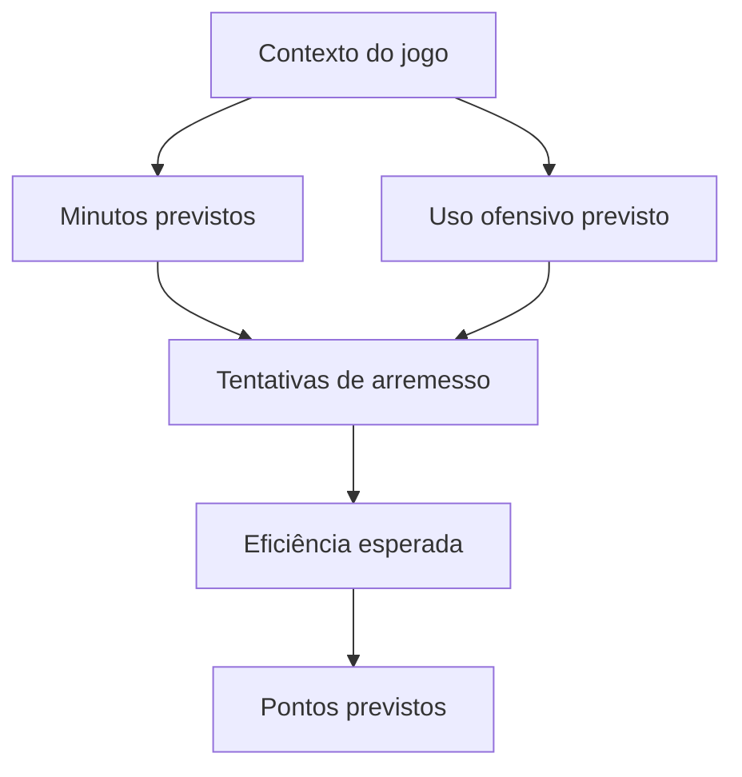

# Planejamento do Módulo de Análise de Jogadores da NBA

**Projeto:** NBA Analytics Lab  
**Objetivo:** analisar a trajetória, o contexto atual e a forma recente dos jogadores para projetar sua pontuação de maneira mais precisa.

> Este módulo é voltado à análise estatística de desempenho esportivo. As projeções representam estimativas com incerteza, não resultados garantidos.

---

## 1. Problema que precisamos resolver

Um jogador pode ter média de 20,8 pontos em uma temporada ou em um time e, após uma mudança de equipe, passar a registrar 26,7 pontos por jogo.

Essa diferença pode ser causada por:

- Aumento ou redução de minutos;
- Mudança entre titular e reserva;
- Maior participação ofensiva;
- Aumento nas tentativas de arremesso;
- Mudança no estilo e ritmo do time;
- Ausência ou chegada de companheiros;
- Mudança de posição ou função;
- Evolução ou queda de eficiência;
- Alteração no nível dos adversários;
- Sequência recente excepcional, positiva ou negativa.

Por isso, não devemos usar apenas a média da carreira ou da temporada. Precisamos preservar o histórico, mas dar mais importância ao contexto atual.

---

## 2. Princípio central

O passado do jogador não será descartado. Ele continuará funcionando como referência de capacidade e estabilidade, porém jogos antigos deverão ter menos influência do que jogos recentes.

Podemos utilizar uma média móvel exponencial:

\[
Peso = e^{-\lambda \times JogosPassados}
\]

Interpretação:

- Jogo mais recente: peso elevado;
- Cinco jogos atrás: peso intermediário;
- Vinte jogos atrás: peso pequeno;
- Temporada anterior: referência histórica;
- Jogos pelo time anterior: peso reduzido após uma transferência.

Isso evita:

1. Continuar prevendo 20,8 quando a função atual produz 26,7;
2. Acreditar que 26,7 será permanente depois de apenas duas ou três partidas.

---

## 3. Segmentação da trajetória

Cada jogador deverá ser analisado em diferentes segmentos.

| Segmento | Descrição |
|---|---|
| Carreira | Todos os jogos disponíveis |
| Temporada | 2023-24, 2024-25, 2025-26 etc. |
| Passagem pelo time | Períodos antes e depois de uma troca |
| Forma recente | Últimos 5, 10, 15 e 20 jogos |
| Função | Titular ou reserva |
| Minutos | Faixas de minutos jogados |
| Contexto do elenco | Com ou sem determinados companheiros |
| Adversário | Histórico contra o próximo time |
| Local | Casa ou fora |
| Descanso | Back-to-back, 1, 2 ou 3+ dias |
| Competição | Temporada regular ou playoffs |

A troca de time deverá criar automaticamente uma nova passagem, chamada de `team_stint`.

---

## 4. Estratégia de previsão

Não devemos prever diretamente apenas a pontuação. A projeção será dividida em componentes.



### 4.1. Previsão de minutos

Variáveis:

- Média recente de minutos;
- Titular ou reserva;
- Minutos depois da mudança de time;
- Rotação do treinador;
- Disponibilidade de companheiros;
- Restrições de minutos;
- Faltas recentes;
- Contexto da partida.

### 4.2. Previsão de volume ofensivo

Variáveis:

- Arremessos tentados;
- Tentativas de três pontos;
- Tentativas de lances livres;
- Usage Rate;
- Posses do time;
- Participação ofensiva;
- Volume sem outros jogadores importantes;
- Ritmo esperado da partida.

### 4.3. Previsão de eficiência

Variáveis:

- Aproveitamento de quadra;
- Aproveitamento de três pontos;
- Aproveitamento de lances livres;
- True Shooting Percentage;
- Eficiência recente;
- Defesa do adversário;
- Defesa adversária por posição;
- Provável defensor principal;
- Nível de dificuldade dos arremessos.

### 4.4. Pontuação final

O resultado será derivado da combinação:

\[
PontosPrevistos =
Minutos +
VolumeOfensivo +
Eficiência +
Contexto
\]

Essa fórmula representa a estrutura conceitual. Os pesos serão aprendidos pelo modelo, e não definidos definitivamente de forma manual.

---

## 5. Tratamento de mudanças de time

O sistema deverá criar variáveis específicas para mudanças de equipe:

```text
current_team
previous_team
team_stint
games_since_trade
days_since_trade
minutes_since_trade
usage_since_trade
points_since_trade
starter_since_trade
shot_attempts_since_trade
```

### Funcionamento

Nos primeiros jogos do novo time:

- O histórico anterior ainda terá influência;
- O novo contexto começará com uma amostra pequena;
- O intervalo de incerteza será maior;
- A confiança da previsão será menor.

Conforme mais partidas forem disputadas:

- O período do time atual ganhará mais peso;
- O período anterior perderá influência;
- O modelo entenderá melhor a nova função;
- O intervalo poderá ficar mais estreito.

---

## 6. Dados necessários

### 6.1. Histórico por partida

- Jogador;
- Time;
- Adversário;
- Data;
- Titular ou reserva;
- Minutos;
- Pontos;
- FGM e FGA;
- FG3M e FG3A;
- FTM e FTA;
- Rebotes;
- Assistências;
- Roubos;
- Bloqueios;
- Turnovers;
- Faltas;
- Plus/Minus.

### 6.2. Forma recente

- Média dos últimos 5 jogos;
- Média dos últimos 10 jogos;
- Média dos últimos 20 jogos;
- Média móvel exponencial;
- Desvio-padrão;
- Maior e menor pontuação;
- Percentual de jogos acima da própria média;
- Tendência crescente ou decrescente;
- Regularidade.

### 6.3. Contexto do time

- Time atual;
- Data de entrada no time;
- Jogos desde a troca;
- Média de minutos no time atual;
- Usage Rate no time atual;
- Ritmo do time;
- Eficiência ofensiva;
- Escalação provável;
- Companheiros disponíveis;
- Posição na rotação.

### 6.4. Contexto da próxima partida

- Adversário;
- Casa ou fora;
- Dias de descanso;
- Jogo consecutivo;
- Ritmo esperado;
- Eficiência defensiva adversária;
- Defesa por posição;
- Confrontos anteriores;
- Provável escalação.

### Fonte inicial

O `PlayerGameLog` do `nba_api` fornece histórico por partida com minutos, pontos, arremessos, rebotes, assistências e outras estatísticas tradicionais.

- [Documentação do PlayerGameLog](https://github.com/swar/nba_api/blob/master/docs/nba_api/stats/endpoints/playergamelog.md)

---

## 7. Segmentadores do dashboard

A página de jogadores deverá conter:

- Temporada;
- Time;
- Últimos N jogos;
- Data inicial e final;
- Casa ou fora;
- Titular ou reserva;
- Adversário;
- Quantidade mínima de minutos;
- Dias de descanso;
- Temporada regular ou playoffs;
- Antes ou depois da mudança de time;
- Com ou sem determinados companheiros.

### Comparação principal

O usuário poderá comparar:

```text
Todos os jogos da temporada
versus
Jogos pelo time atual
versus
Últimos 10 jogos
```

---

## 8. Página de trajetória do jogador

### 8.1. Indicadores

- Média na carreira;
- Média por temporada;
- Média pelo time atual;
- Média nos últimos 5 jogos;
- Média nos últimos 10 jogos;
- Média nos últimos 20 jogos;
- Minutos previstos;
- Pontos previstos;
- Intervalo provável;
- Grau de confiança.

### 8.2. Gráficos

- Pontos por partida;
- Média móvel de pontos;
- Minutos por partida;
- Tentativas de arremesso;
- Usage Rate;
- Aproveitamento;
- Distribuição de pontuação;
- Linha indicando a data da troca de time;
- Comparação entre as passagens pelos times.

### Exemplo de apresentação

```text
Temporada anterior:       20,8 pontos
Antes da troca:           21,1 pontos
Depois da troca:          26,7 pontos
Últimos 10 jogos:         27,3 pontos
Projeção do próximo jogo: 25,4 pontos
Intervalo provável:       19 a 31 pontos
Confiança:                média
```

A projeção poderá ficar abaixo da média recente se o modelo identificar aproveitamento excepcional, adversário defensivamente forte ou redução provável de minutos.

---

## 9. Modelo de forma recente

O modelo deverá combinar:

- Últimos 5 jogos;
- Últimos 10 jogos;
- Últimos 20 jogos;
- Média móvel exponencial;
- Média no time atual;
- Média da temporada;
- Referência histórica;
- Similaridade do próximo adversário;
- Mudança de função;
- Minutos e volume esperados.

Os pesos definitivos deverão ser aprendidos e avaliados em dados históricos.

### Proteção contra reação exagerada

Uma sequência curta não deverá substituir imediatamente o histórico. Podemos utilizar regularização e combinação com a média de longo prazo.

Exemplo:

- Poucos jogos pelo time novo: maior peso histórico;
- Amostra intermediária: combinação equilibrada;
- Muitos jogos pelo time novo: maior peso no contexto atual.

---

## 10. Modelos recomendados

### Modelo de referência

- Média da temporada;
- Média dos últimos 5;
- Média dos últimos 10;
- Regressão Ridge.

### Modelos de comparação

- Random Forest;
- Gradient Boosting;
- HistGradientBoosting;
- XGBoost ou LightGBM em versões futuras.

### Intervalos

Utilizar:

- Regressão quantílica;
- Distribuição dos resíduos;
- Conformal Prediction em uma evolução futura.

Exemplo de saída:

```text
Pontos centrais: 25,4
Intervalo de 50%: 23–28
Intervalo de 80%: 19–31
Confiança: média
```

---

## 11. Validação correta

O treinamento deverá respeitar a ordem temporal.

1. Treinar com os jogos anteriores;
2. Prever o jogo seguinte;
3. Registrar previsão e resultado;
4. Calcular o erro;
5. Avançar para a próxima data;
6. Repetir o processo.

Essa estratégia é chamada de validação progressiva ou `walk-forward validation`.

### Métricas

- MAE de pontos;
- RMSE;
- Erro por jogador;
- Erro por quantidade de minutos;
- Erro por temporada;
- Erro antes e depois de trocas;
- Erro nos primeiros jogos pelo novo time;
- Cobertura dos intervalos;
- Erro por nível de confiança.

### Referências que o modelo deve superar

- Média da temporada;
- Média dos últimos 5 jogos;
- Média dos últimos 10 jogos;
- Média pelo time atual.

Se o modelo complexo não superar essas referências, ele ainda não deverá ser considerado melhor.

---

## 12. Proteção contra vazamento de dados

Para prever uma partida, somente poderão ser usadas informações disponíveis antes do início daquele jogo.

Não poderão entrar no treinamento daquela previsão:

- Pontuação do próprio jogo;
- Minutos do próprio jogo;
- Escalação confirmada depois do horário da previsão;
- Médias calculadas incluindo o jogo previsto;
- Informações publicadas posteriormente.

Cada variável móvel deverá utilizar `shift(1)` ou processamento sequencial equivalente.

---

## 13. Estrutura do banco de dados

### Tabelas novas

```text
players
player_game_logs
player_team_stints
player_rolling_features
player_predictions
player_prediction_results
```

### Responsabilidades

| Tabela | Responsabilidade |
|---|---|
| `players` | Cadastro dos jogadores |
| `player_game_logs` | Estatísticas por partida |
| `player_team_stints` | Passagens por cada time |
| `player_rolling_features` | Médias e tendências pré-calculadas |
| `player_predictions` | Projeções registradas antes dos jogos |
| `player_prediction_results` | Comparação entre previsão e resultado |

---

## 14. Estrutura de código

Novos módulos:

```text
src/player_connector.py
src/player_features.py
src/player_model.py
src/player_trajectory.py
src/player_storage.py
```

Nova página:

```text
pages/2_Jogadores.py
```

Novos testes:

```text
tests/test_player_connector.py
tests/test_player_features.py
tests/test_player_model.py
tests/test_player_storage.py
```

---

## 15. Etapas de implementação

### Etapa 1 — Coleta

- Cadastrar jogadores;
- Buscar histórico por temporada;
- Salvar partidas no SQLite;
- Evitar duplicações;
- Detectar mudanças de time;
- Atualizar dados incrementalmente.

### Etapa 2 — Trajetória

- Calcular últimos 5, 10 e 20 jogos;
- Calcular média móvel exponencial;
- Criar passagens por time;
- Criar segmentadores;
- Adicionar gráficos;
- Comparar temporada, time atual e forma recente.

### Etapa 3 — Previsão

- Modelo de minutos;
- Modelo de volume ofensivo;
- Modelo de eficiência;
- Modelo de pontos;
- Intervalos de incerteza;
- Explicação dos fatores.

### Etapa 4 — Validação

- Registrar previsões antes dos jogos;
- Comparar com os resultados;
- Calcular erros;
- Avaliar períodos de troca;
- Comparar com modelos simples;
- Retreinar somente quando houver benefício comprovado.

---

## 16. Critérios de conclusão

O módulo será considerado funcional quando:

- Permitir selecionar um jogador;
- Permitir filtrar temporada, time e período;
- Exibir a trajetória cronológica;
- Detectar mudanças de equipe;
- Calcular forma recente sem vazamento;
- Projetar minutos e pontos;
- Exibir intervalos de incerteza;
- Explicar os principais fatores;
- Registrar previsão e resultado;
- Medir o desempenho do modelo.

---

## 17. Resultado esperado

O sistema deverá analisar a evolução do jogador sem:

- Ignorar o histórico;
- Tratar todas as temporadas igualmente;
- Dar importância exagerada a poucos jogos;
- Misturar informações futuras;
- Apresentar uma pontuação como certeza.

A previsão final deverá equilibrar:

```text
Capacidade histórica
+ Forma recente
+ Função no time atual
+ Minutos esperados
+ Volume ofensivo
+ Eficiência
+ Contexto do adversário
+ Incerteza
```
