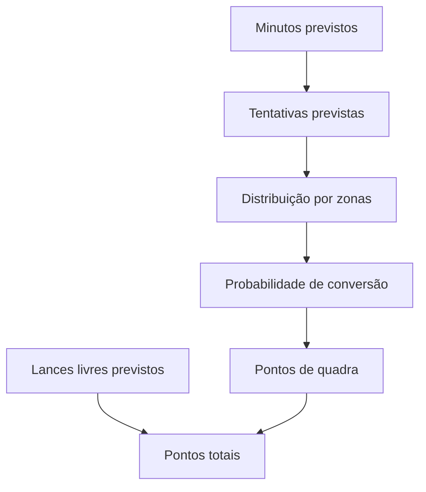

# Planejamento do Módulo de Mapa de Arremessos da NBA

**Projeto:** NBA Analytics Lab  
**Objetivo:** identificar de onde cada jogador mais arremessa, medir sua eficiência por região e melhorar a precisão das projeções esportivas.

> Este módulo é voltado à análise esportiva e ciência de dados. Não inclui recursos ou orientações de apostas.

---

## 1. Objetivo do módulo

O sistema deverá responder:

- De quais regiões da quadra o jogador mais arremessa?
- Em quais regiões ele é mais eficiente?
- Como seu perfil mudou entre temporadas?
- Como uma mudança de time alterou seus arremessos?
- Quais tipos de arremesso ele mais utiliza?
- Como o adversário influencia sua distribuição?
- Qual é a distribuição provável no próximo jogo?

Para isso, devemos separar:

1. Frequência;
2. Eficiência;
3. Tipo de arremesso;
4. Contexto;
5. Evolução temporal;
6. Defesa adversária;
7. Incerteza.

---

## 2. Dados de cada arremesso

O endpoint `ShotChartDetail` disponibiliza informações como:

- `LOC_X` e `LOC_Y`: posição do arremesso;
- `SHOT_DISTANCE`: distância da cesta;
- `SHOT_ZONE_BASIC`: zona básica;
- `SHOT_ZONE_AREA`: lado ou região;
- `SHOT_ZONE_RANGE`: faixa de distância;
- `SHOT_TYPE`: arremesso de 2 ou 3 pontos;
- `ACTION_TYPE`: bandeja, enterrada, jump shot etc.;
- `SHOT_MADE_FLAG`: convertido ou errado;
- `PERIOD`: período;
- `MINUTES_REMAINING`;
- `SECONDS_REMAINING`;
- Data, jogo, jogador, time e adversário.

Esses campos permitem reconstruir os arremessos na meia quadra.

- [Documentação do ShotChartDetail](https://github.com/swar/nba_api/blob/master/docs/nba_api/stats/endpoints/shotchartdetail.md)

---

## 3. Visualizações

### 3.1. Mapa de pontos

Cada tentativa aparece na posição em que ocorreu:

- Verde: convertido;
- Vermelho: errado;
- Transparência indicando concentração;
- Tooltip com jogo, período, distância e tipo.

Esse formato é útil para examinar tentativas individuais, mas pode ficar poluído com grandes amostras.

### 3.2. Mapa de calor

Mostra onde o jogador mais tenta:

- Área mais intensa: maior volume;
- Área menos intensa: menor volume.

O mapa de calor deve representar frequência, não eficiência.

### 3.3. Mapa hexagonal

A quadra será dividida em hexágonos:

- Tamanho: quantidade de tentativas;
- Cor: aproveitamento;
- Contorno: diferença para a média da liga;
- Tooltip: FGA, FGM, FG% e pontos por tentativa.

Esse será o formato principal do dashboard.

### 3.4. Mapa por zonas

Divisão sugerida:

- Aro;
- Garrafão;
- Meia distância;
- Canto esquerdo de três;
- Canto direito de três;
- Três frontal;
- Três lateral;
- Arremessos muito longos.

---

## 4. Frequência e eficiência

Frequência e eficiência deverão ser analisadas separadamente.

| Métrica | Significado |
|---|---|
| FGA | Tentativas |
| FGM | Conversões |
| FG% | Aproveitamento |
| Frequência | Percentual dos arremessos naquela zona |
| Pontos por tentativa | Produção média por arremesso |
| Diferença da liga | Eficiência contra a média da NBA |
| Amostra | Quantidade de tentativas |

Exemplo:

| Zona | Tentativas | Frequência | FG% | Pontos/tentativa |
|---|---:|---:|---:|---:|
| Aro | 80 | 32% | 67% | 1,34 |
| Meia distância | 50 | 20% | 44% | 0,88 |
| Canto de três | 35 | 14% | 40% | 1,20 |
| Três frontal | 85 | 34% | 36% | 1,08 |

---

## 5. Pontos esperados por região

Para cada zona:

\[
PontosEsperadosPorTentativa =
ValorDoArremesso \times ProbabilidadeDeConversão
\]

Exemplo de dois pontos:

\[
2 \times 0{,}55 = 1{,}10
\]

Exemplo de três pontos:

\[
3 \times 0{,}38 = 1{,}14
\]

Quando disponível, também deveremos considerar a capacidade da região ou tipo de jogada de gerar lances livres.

---

## 6. Proteção contra amostras pequenas

Um jogador que acerta 3 de 4 tentativas não deve ser tratado automaticamente como alguém com eficiência real de 75%.

O sistema deverá:

- Mostrar a quantidade de tentativas;
- Exigir amostra mínima;
- Reduzir a confiança em regiões pouco utilizadas;
- Comparar com o histórico;
- Comparar com a média da liga;
- Aplicar regularização;
- Exibir intervalo de confiança.

Podemos utilizar suavização bayesiana para aproximar aproveitamentos de amostras pequenas da média geral.

---

## 7. Evolução do perfil de arremessos

O sistema não deverá misturar toda a carreira como se o jogador tivesse sempre o mesmo perfil.

Segmentadores:

- Temporada;
- Time;
- Passagem pelo time;
- Últimos 5, 10, 20 ou 40 jogos;
- Data inicial e final;
- Casa ou fora;
- Adversário;
- Período da partida;
- Vitória ou derrota;
- Temporada regular ou playoffs;
- Faixa de minutos.

Comparações:

```text
Temporada anterior × temporada atual
Time anterior × time atual
Primeiros 10 jogos × últimos 10 jogos
Casa × fora
Antes da troca × depois da troca
```

Mudanças que deverão ser identificadas:

- Aumento das tentativas no aro;
- Aumento das tentativas de três;
- Redução da meia distância;
- Mudança de lado da quadra;
- Alteração de aproveitamento;
- Mudança no tipo de finalização.

---

## 8. Contexto do arremesso

Quando os dados estiverem disponíveis:

- Catch-and-shoot;
- Pull-up;
- Número de dribles;
- Tempo de posse antes do arremesso;
- Distância do defensor;
- Tempo restante no relógio;
- Arremesso assistido ou criado pelo jogador;
- Transição ou meia quadra;
- Período;
- Situação do placar;
- Companheiros em quadra.

Nem todos esses campos estão no `ShotChartDetail`. O projeto poderá combinar outros endpoints de tracking e splits.

- [Documentação do PlayerDashboardByGeneralSplits](https://github.com/swar/nba_api/blob/master/docs/nba_api/stats/endpoints/playerdashboardbygeneralsplits.md)

---

## 9. Defesa adversária

A previsão deverá cruzar o perfil ofensivo do jogador com o perfil defensivo do adversário.

Exemplo conceitual:

```text
Jogador:
- 38% das tentativas no aro
- 27% em três frontal
- 18% nos cantos
- 17% na meia distância

Adversário:
- Protege bem o aro
- Permite tentativas nos cantos
- Cede aproveitamento no três frontal
```

O modelo deverá prever uma possível mudança na distribuição dos arremessos, não apenas aplicar a média geral.

---

## 10. Modelo de previsão



Pontuação esperada:

\[
E[Pontos] =
2 \times E[ArremessosDe2Convertidos]
+ 3 \times E[ArremessosDe3Convertidos]
+ E[LancesLivresConvertidos]
\]

Conversões esperadas:

\[
E[Conversões] =
TentativasPrevistas \times ProbabilidadeDeConversão
\]

---

## 11. Estrutura do banco de dados

### Novas tabelas

```text
player_shots
player_shot_zones
player_shot_features
player_shot_predictions
opponent_zone_defense
```

### Campos de `player_shots`

```text
player_id
player_name
game_id
game_event_id
season
game_date
team_id
team_name
opponent
period
minutes_remaining
seconds_remaining
event_type
action_type
shot_type
shot_zone_basic
shot_zone_area
shot_zone_range
shot_distance
loc_x
loc_y
shot_attempted
shot_made
source
```

Chave sugerida:

```text
player_id + game_id + game_event_id
```

---

## 12. Estrutura de código

```text
src/shot_connector.py
src/shot_storage.py
src/shot_features.py
src/shot_model.py
src/court_chart.py
pages/3_Mapa_Arremessos.py
```

Testes:

```text
tests/test_shot_connector.py
tests/test_shot_storage.py
tests/test_shot_features.py
tests/test_shot_model.py
tests/test_court_chart.py
```

---

## 13. Página de mapa de arremessos

Segmentadores:

- Jogador;
- Temporada;
- Time;
- Últimos N jogos;
- Data inicial e final;
- Adversário;
- Casa ou fora;
- Zona;
- Tipo de arremesso;
- Convertidos, errados ou todos;
- Período.

Elementos:

- Mapa de pontos;
- Mapa de calor;
- Mapa hexagonal;
- Tabela por zona;
- Comparação com a liga;
- Evolução temporal;
- Distribuição por tipo;
- Projeção do próximo jogo.

---

## 14. Indicadores

- Total de tentativas;
- Total de conversões;
- FG%;
- eFG%;
- Pontos por tentativa;
- Distância média;
- Zona mais utilizada;
- Zona mais eficiente;
- Zona com maior diferença positiva para a liga;
- Zona com maior volume e baixa eficiência;
- Percentual no aro;
- Percentual de três;
- Percentual de meia distância.

---

## 15. Características para o modelo

### Volume

- FGA por minuto;
- FGA nos últimos 5, 10 e 20 jogos;
- FGA por passagem no time;
- Frequência por zona;
- Minutos previstos;
- Usage Rate;
- Pace esperado.

### Eficiência

- FG% por zona;
- Média móvel por zona;
- Diferença para a liga;
- Distância;
- Tipo de arremesso;
- Eficiência histórica;
- Eficiência recente;
- Defesa adversária na região.

### Contexto

- Casa ou fora;
- Descanso;
- Adversário;
- Passagem pelo time;
- Jogos desde a troca;
- Período;
- Companheiros disponíveis.

---

## 16. Modelos recomendados

### Probabilidade de conversão

- Regressão logística como referência;
- Gradient Boosting;
- HistGradientBoosting;
- XGBoost ou LightGBM futuramente.

### Quantidade de tentativas

- Regressão Ridge como referência;
- Gradient Boosting;
- Modelos de contagem;
- Regressão quantílica para intervalos.

### Distribuição por zonas

- Classificação multiclasse;
- Modelo proporcional por região;
- Ajuste pela defesa adversária;
- Regularização para amostras pequenas.

---

## 17. Validação

Métricas:

- Log Loss para conversão;
- Brier Score para probabilidades;
- MAE para número de tentativas;
- MAE para pontos;
- Calibração;
- Cobertura dos intervalos;
- Erro por zona;
- Erro por jogador;
- Erro após mudança de time;
- Erro por tamanho de amostra.

A validação deverá seguir a ordem cronológica.

---

## 18. Proteção contra vazamento

Somente informações disponíveis antes da partida poderão ser usadas.

Não poderão entrar:

- Resultado do arremesso previsto;
- Arremessos do próprio jogo-alvo;
- Estatísticas calculadas incluindo o jogo-alvo;
- Informações futuras;
- Escalações confirmadas depois da previsão.

Médias móveis deverão utilizar `shift(1)` ou processamento sequencial equivalente.

---

## 19. Etapas de implementação

### Etapa 1 — Coleta e armazenamento

- Conectar ao `ShotChartDetail`;
- Normalizar as coordenadas;
- Salvar no SQLite;
- Evitar duplicações;
- Atualizar por temporada;
- Tratar falhas da API.

### Etapa 2 — Análise por zonas

- Agrupar arremessos;
- Calcular volume;
- Calcular eficiência;
- Calcular pontos por tentativa;
- Adicionar segmentadores;
- Criar tabela comparativa.

### Etapa 3 — Visualizações

- Desenhar a quadra;
- Adicionar mapa de pontos;
- Adicionar mapa de calor;
- Adicionar mapa hexagonal;
- Marcar mudanças de time.

### Etapa 4 — Comparação

- Comparar temporadas;
- Comparar times;
- Comparar forma recente;
- Comparar com a liga;
- Adicionar defesa adversária.

### Etapa 5 — Previsão

- Prever minutos;
- Prever tentativas;
- Prever distribuição por zonas;
- Prever eficiência;
- Gerar pontos esperados;
- Criar intervalos.

---

## 20. Critérios de conclusão

O módulo estará funcional quando:

- Buscar arremessos de um jogador;
- Salvar sem duplicações;
- Filtrar temporada e time;
- Exibir mapa de pontos;
- Exibir mapa de calor;
- Exibir mapa hexagonal;
- Calcular frequência e eficiência por zona;
- Comparar períodos;
- Mostrar tamanho da amostra;
- Proteger contra vazamento;
- Validar o modelo cronologicamente.

---

## 21. Ordem recomendada

1. Coleta pelo `ShotChartDetail`;
2. SQLite;
3. Mapa por zonas;
4. Mapa de pontos;
5. Mapa hexagonal;
6. Comparações temporais;
7. Ajuste por amostra;
8. Defesa adversária;
9. Previsão de tentativas;
10. Previsão de eficiência;
11. Distribuição de pontos.
