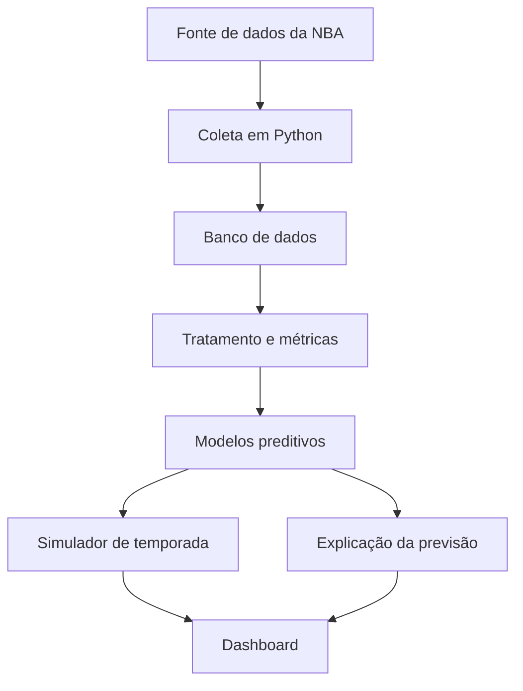
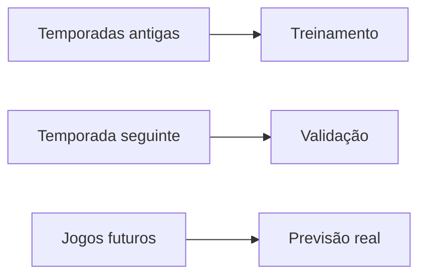

# Planejamento — Programa de Análise e Previsão de Cenários da NBA

**Data:** 15 de agosto de 2026  
**Objetivo:** planejar um programa capaz de analisar jogos, times e jogadores da NBA e produzir previsões probabilísticas de cenários futuros.

> Projeto voltado à análise esportiva e ciência de dados. As previsões representam probabilidades, não certezas.

---

## 1. Conversa inicial

### Solicitação

> Quero criar um Programa que analisa Jogos de Basquete da NBA e analisa os Jogadores e times, quero analisar para tentar prever cenários futuros.

### Respostas de definição

- **Formato inicial:** planejar antes de programar.
- **Previsões do MVP:** probabilidade de vitória, pontuação provável, desempenho dos jogadores, classificação e playoffs.
- **Nível de programação:** iniciante.

---

## 2. Direção recomendada

A melhor estratégia é começar como um projeto de ciência de dados em Python e, depois que a coleta e os modelos estiverem funcionando, transformá-lo em uma plataforma web.

O sistema deverá responder perguntas como:

- Qual é a probabilidade de cada time vencer?
- Qual pontuação final é mais provável?
- Quantos pontos, rebotes e assistências um jogador pode registrar?
- Como ausências, descanso, mando de quadra e sequência recente alteram o cenário?
- Qual é a probabilidade de um time chegar aos playoffs?
- Quais fatores mais influenciaram cada previsão?

### Exemplo de saída

```text
Boston Celtics: 64% de probabilidade de vitória
New York Knicks: 36% de probabilidade de vitória
Pontuação prevista: Celtics 116–111 Knicks
Intervalo provável: Celtics 108–123 | Knicks 103–119
Confiança do modelo: média
```

---

## 3. Escopo do MVP

### 3.1. Módulo de times

Análises:

- Vitórias e derrotas;
- Desempenho em casa e fora;
- Pontos feitos e sofridos;
- Eficiência ofensiva e defensiva;
- Ritmo de jogo;
- Últimos 5, 10 e 20 jogos;
- Confrontos diretos;
- Dias de descanso;
- Jogos em noites consecutivas;
- Desfalques importantes.

Previsões:

- Probabilidade de vitória;
- Pontos de cada time;
- Diferença esperada no placar.

### 3.2. Módulo de jogadores

Análises:

- Minutos, pontos, rebotes e assistências;
- Roubos, bloqueios e faltas;
- Aproveitamento e tentativas de arremessos;
- Uso ofensivo e regularidade;
- Forma nos últimos jogos;
- Desempenho contra o adversário;
- Desempenho com ou sem determinados companheiros;
- Possíveis alterações de minutos.

Previsões:

- Pontos, rebotes e assistências;
- Minutos esperados;
- Intervalo provável de cada estatística;
- Probabilidade de atingir marcas estatísticas esportivas internas.

### 3.3. Módulo de temporada

O sistema deverá simular o restante da temporada milhares de vezes para estimar:

- Número final de vitórias;
- Posição na conferência;
- Probabilidade de classificação direta;
- Probabilidade de Play-In;
- Probabilidade de playoffs;
- Possíveis confrontos.

---

## 4. Arquitetura sugerida



### Tecnologias

| Parte | Tecnologia inicial | Evolução futura |
|---|---|---|
| Linguagem | Python | Python |
| Manipulação | Pandas | Pandas ou Polars |
| Banco | SQLite | PostgreSQL ou Supabase |
| Modelos | Scikit-learn | XGBoost ou LightGBM |
| Dashboard | Streamlit | React com FastAPI |
| Gráficos | Plotly | Plotly ou Recharts |
| Agendamento | Script manual | Tarefa automática |
| Hospedagem | Streamlit Community Cloud | Render ou Vercel |

Para um iniciante, Python e Streamlit reduzem a complexidade, pois permitem criar coleta, análise, modelos e interface usando principalmente uma única linguagem.

---

## 5. Dados necessários

### Jogos

- ID, data e temporada;
- Mandante e visitante;
- Placar e pontos por período;
- Temporada regular ou playoffs.

### Times

- Posses estimadas;
- Offensive Rating;
- Defensive Rating;
- Net Rating;
- Pace;
- Aproveitamento de 2 e 3 pontos;
- Rebotes, turnovers e lances livres.

### Jogadores

- Jogador, time e adversário;
- Titular ou reserva;
- Minutos;
- Pontos, rebotes e assistências;
- Arremessos tentados e convertidos;
- Faltas, roubos e bloqueios.

### Contexto

- Mando de quadra;
- Dias de descanso;
- Jogos consecutivos;
- Distância da viagem;
- Lesões e ausências;
- Mudanças no elenco;
- Provável escalação.

### Fontes consideradas

- [nba_api](https://github.com/swar/nba_api): biblioteca Python que facilita o acesso aos endpoints estatísticos da NBA.com.
- [Exemplos do nba_api](https://github.com/swar/nba_api/blob/master/docs/nba_api/stats/examples.md): consultas de jogadores, times e estatísticas.
- [BALLDONTLIE](https://www.balldontlie.io/docs): API com partidas, jogadores, estatísticas e classificação.
- [Referência NBA da BALLDONTLIE](https://nba.balldontlie.io/): documentação específica da NBA.

Para o primeiro protótipo, a recomendação é usar `nba_api` e salvar os dados históricos localmente.

---

## 6. Funcionamento das previsões

### Probabilidade de vitória

O primeiro modelo recomendado é a **regressão logística**.

Possíveis variáveis:

```text
net_rating_recente
vantagem_mando
dias_descanso
eficiencia_ofensiva
eficiencia_defensiva
desempenho_fora_casa
forca_adversario
ausencias_importantes
```

Saída:

```text
probabilidade_time_casa = 0.64
probabilidade_visitante = 0.36
```

Depois, o resultado poderá ser comparado com Random Forest, Gradient Boosting, XGBoost e LightGBM. Redes neurais não são prioridade inicialmente, pois modelos menores são mais simples de treinar, explicar e validar em dados tabulares.

### Pontuação provável

Serão usados inicialmente dois modelos:

```text
modelo_pontos_mandante
modelo_pontos_visitante
```

Cada modelo produzirá uma pontuação central e limites inferior e superior.

```text
Mandante: 116 pontos — intervalo de 108 a 123
Visitante: 111 pontos — intervalo de 103 a 119
```

### Desempenho dos jogadores

A previsão será dividida em:

1. Minutos esperados;
2. Produção por minuto;
3. Estatística final.

```text
minutos previstos = 34
pontos por minuto previstos = 0,72
pontos previstos = 24,5
```

Esse método ajuda o modelo a reagir a mudanças de titularidade e restrições de minutos.

### Classificação e playoffs

1. Prever cada jogo restante;
2. Sortear o resultado de acordo com a probabilidade;
3. Atualizar a classificação;
4. Repetir o processo, por exemplo, 10.000 vezes;
5. Contar quantas vezes cada time terminou em cada posição.

Essa técnica é uma **simulação de Monte Carlo**.

---

## 7. Validação

O modelo não deverá ser testado misturando aleatoriamente passado e futuro, pois isso provocaria vazamento de dados.



| Previsão | Métricas |
|---|---|
| Vencedor | Accuracy, Log Loss e Brier Score |
| Pontuação | MAE e RMSE |
| Jogadores | MAE por estatística |
| Probabilidades | Curva de calibração |
| Classificação | Erro médio de posição |

Uma previsão de 70% deve se concretizar aproximadamente sete vezes em cada dez casos semelhantes. Não basta acertar o vencedor; a probabilidade também precisa estar calibrada.

---

## 8. Telas do dashboard

### Página inicial

- Jogos do dia;
- Probabilidade de vitória;
- Placar previsto;
- Grau de confiança;
- Principais fatores.

### Times

- Forma recente;
- Eficiência ofensiva e defensiva;
- Desempenho em casa e fora;
- Evolução na temporada;
- Comparação entre dois times.

### Jogadores

- Médias e médias móveis;
- Consistência;
- Desempenho por adversário;
- Projeção do próximo jogo;
- Comparação entre jogadores.

### Temporada

- Classificação atual e projetada;
- Probabilidade de playoffs;
- Distribuição de vitórias;
- Simulador de cenários.

### Desempenho do modelo

- Previsões anteriores;
- Resultado real;
- Erros;
- Acurácia por período;
- Versão do modelo.

---

## 9. Cronograma

### Fase 1 — Fundamentos: 1 a 2 semanas

- Python básico;
- Pandas;
- Jupyter Notebook;
- Leitura de CSV;
- Limpeza, agrupamento e gráficos.

### Fase 2 — Coleta: 1 semana

- Conectar com a API;
- Baixar jogos e estatísticas;
- Salvar os dados;
- Evitar duplicações;
- Criar atualização incremental.

### Fase 3 — Análise: 2 semanas

- Médias móveis;
- Ratings;
- Casa contra fora;
- Forma recente;
- Comparações entre jogadores e times.

### Fase 4 — Primeiro modelo: 2 semanas

- Criar variáveis;
- Separar treino e teste por data;
- Treinar regressão logística;
- Avaliar probabilidades;
- Registrar previsões.

### Fase 5 — Pontuação e jogadores: 2 a 3 semanas

- Regressão de pontos;
- Previsão de minutos;
- Projeções individuais;
- Intervalos de incerteza.

### Fase 6 — Simulação: 1 a 2 semanas

- Simular jogos restantes;
- Reproduzir critérios de classificação;
- Calcular probabilidades de playoffs.

### Fase 7 — Dashboard: 2 semanas

- Criar páginas no Streamlit;
- Adicionar filtros e gráficos;
- Exibir explicações;
- Publicar o protótipo.

**Estimativa:** aproximadamente 10 a 14 semanas para um MVP funcional, estudando e desenvolvendo algumas horas por semana.

---

## 10. Ordem de implementação

1. Baixar três temporadas de jogos;
2. Criar uma tabela limpa;
3. Fazer um dashboard histórico sem previsões;
4. Calcular médias dos últimos 5 e 10 jogos;
5. Criar o modelo de vencedor;
6. Salvar cada previsão antes do jogo;
7. Comparar previsão e resultado;
8. Criar o modelo de pontuação;
9. Adicionar jogadores;
10. Adicionar simulação da classificação;
11. Automatizar a atualização;
12. Publicar o sistema.

---

## 11. Primeiro marco

> Selecionar dois times e receber uma análise histórica, uma comparação de desempenho e uma probabilidade experimental de vitória.

Esse marco fornecerá uma base verificável para o restante do projeto.

---

## 12. Próximo passo sugerido

Criar a documentação técnica da versão 1, contendo:

- Estrutura de pastas;
- Modelo inicial do banco de dados;
- Lista de tarefas por etapa;
- Critérios de conclusão do MVP;
- Especificação das telas;
- Primeiro script de coleta da NBA.
