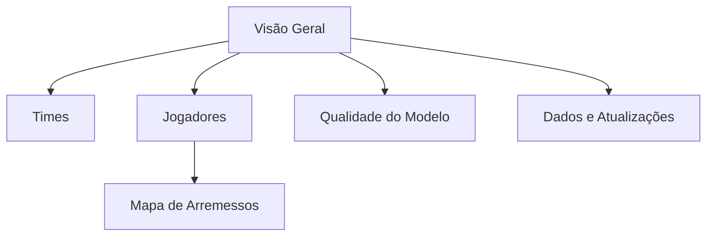

# Planejamento de UI e UX — NBA Analytics Lab

## 1. Objetivo

Este documento define melhorias de interface e experiência do usuário para o **NBA Analytics Lab**, um sistema de análise esportiva voltado a jogadores, times, partidas, trajetórias de desempenho e projeções estatísticas.

As principais metas são:

- reduzir a quantidade de informações exibidas ao mesmo tempo;
- facilitar a navegação para usuários iniciantes;
- deixar clara a origem e a atualização dos dados;
- explicar projeções e incertezas de forma simples;
- permitir análises por temporada, time, período e contexto;
- transformar estatísticas em informações fáceis de interpretar.

> O projeto deve permanecer focado em análise esportiva e previsões estatísticas, sem recursos destinados a apostas.

## 2. Estratégia de tecnologia

Durante o desenvolvimento dos modelos e da coleta de dados, a recomendação é continuar usando **Streamlit**, pois ele permite construir e testar telas rapidamente.

Uma migração para **React** pode ser considerada posteriormente, quando:

- os modelos estiverem mais estáveis;
- a estrutura das páginas já estiver validada;
- houver necessidade de maior personalização visual;
- o projeto precisar oferecer uma experiência mais próxima de um produto comercial.

## 3. Arquitetura de navegação

O sistema deve ser dividido em páginas com responsabilidades claras.



| Página | Finalidade |
|---|---|
| Visão Geral | Resumo do banco de dados, destaques e atalhos principais |
| Times | Comparação, forma recente e projeções de equipes |
| Jogadores | Trajetória, desempenho recente e projeção individual |
| Mapa de Arremessos | Frequência, eficiência e distribuição espacial dos arremessos |
| Qualidade do Modelo | Erros, calibração, histórico e confiança das previsões |
| Dados e Atualizações | Importação, temporadas, NBA API, CSV e banco SQLite |

A atualização dos dados deve ficar separada das telas de análise. Isso evita que o usuário confunda a tarefa de importar dados com a tarefa de explorar resultados.

## 4. Página inicial — Visão Geral

A página inicial precisa responder rapidamente:

1. Existem dados disponíveis?
2. Quando eles foram atualizados?
3. Quantos jogos, jogadores, times e temporadas estão registrados?
4. Os dados são reais, importados ou apenas demonstrativos?
5. Qual é a qualidade geral dos modelos?

### 4.1 Cartões de resumo

Exemplo de cartões:

- **1.230 jogos** analisados;
- **30 times** cadastrados;
- **184 jogadores** com amostra válida;
- **3 temporadas** disponíveis;
- **Última atualização:** 16/08/2026 às 14:30;
- **Fonte:** NBA API.

### 4.2 Ações principais

Os botões principais podem ser:

- Analisar times;
- Analisar jogadores;
- Abrir mapa de arremessos;
- Atualizar dados.

## 5. Identificação permanente da fonte dos dados

Cada página deve mostrar a fonte e a data de atualização. O usuário não deve precisar procurar essa informação.

### 5.1 Selos recomendados

| Estado | Cor sugerida | Significado |
|---|---|---|
| DEMONSTRAÇÃO | Amarelo | Dados fictícios ou preparados para exemplo |
| NBA API — DADOS REAIS | Azul | Dados obtidos diretamente da fonte configurada |
| CSV IMPORTADO | Roxo | Dados enviados pelo usuário |
| DADOS DESATUALIZADOS | Laranja | A última atualização ultrapassou o limite esperado |
| FALHA NA ATUALIZAÇÃO | Alerta | A importação não foi concluída |

Exemplo:

> Fonte: NBA API · Atualizado em 16/08/2026 às 14:30 · Temporadas: 2023-24 a 2025-26

## 6. Página de jogador

Essa página deve apresentar a evolução do atleta sem sobrecarregar a interface.

### 6.1 Cabeçalho

O cabeçalho pode conter:

- nome do jogador;
- time atual;
- temporadas disponíveis;
- quantidade de jogos analisados;
- data do último jogo;
- fonte dos dados.

### 6.2 Indicadores principais

Mostrar os indicadores mais úteis:

- média de pontos na temporada;
- média no time atual;
- média nos últimos 5 jogos;
- média nos últimos 10 jogos;
- minutos recentes;
- pontos projetados;
- intervalo provável;
- confiança da projeção.

### 6.3 Abas sugeridas

1. **Resumo** — principais números e forma recente;
2. **Trajetória** — evolução por jogo, mês, temporada e time;
3. **Arremessos** — mapas e zonas da quadra;
4. **Contexto** — adversário, mando, descanso e função no time;
5. **Projeção** — estimativa de desempenho futuro;
6. **Qualidade do modelo** — erro histórico e confiabilidade.

## 7. Barra de filtros

Os filtros devem ficar em uma área única, visível e reutilizável.

### 7.1 Filtros recomendados

- temporada;
- time;
- últimos N jogos;
- casa ou fora;
- adversário;
- mínimo de minutos jogados;
- antes ou depois de uma troca de time;
- temporada regular ou playoffs.

### 7.2 Comportamento dos filtros

- oferecer um botão **Limpar filtros**;
- preservar os filtros ao mudar de aba;
- usar valores padrão úteis;
- informar quantos jogos permaneceram na amostra;
- alertar quando a amostra for pequena.

Exemplo:

> Exibindo 18 de 74 partidas · Amostra moderada

## 8. Mapa de arremessos

Uma distribuição eficiente da tela pode usar três áreas:

- **lado esquerdo:** filtros;
- **centro:** quadra e visualização dos arremessos;
- **lado direito:** indicadores e interpretação automática.

### 8.1 Modos de visualização

- Tentativas;
- Mapa de calor;
- Mapa hexagonal;
- Zonas da quadra;
- Comparação entre períodos.

### 8.2 Controles rápidos

- todos os arremessos;
- convertidos;
- errados;
- dois pontos;
- três pontos;
- últimos N jogos.

### 8.3 Informações ao passar o cursor

Cada região deve apresentar:

- nome da zona;
- tentativas;
- acertos;
- aproveitamento;
- frequência de uso;
- média da liga;
- tamanho da amostra.

## 9. Cores e acessibilidade nos gráficos

Não se deve depender apenas da combinação vermelho e verde. Pessoas com daltonismo podem ter dificuldade para distinguir esses estados.

Sugestão:

- azul: desempenho abaixo da referência;
- cinza: desempenho próximo da referência;
- laranja: desempenho acima da referência;
- tamanho do hexágono ou círculo: volume de tentativas;
- símbolo preenchido ou vazado: convertido ou errado.

Os gráficos também devem ter legendas, rótulos e tabelas alternativas sempre que possível.

## 10. Explicações automáticas

O sistema deve interpretar os números com frases curtas. Isso ajuda usuários iniciantes a entender por que uma estatística mudou.

Exemplo:

> O jogador concentra 39% das tentativas próximas ao aro. Desde a mudança de time, aumentou em 8 pontos percentuais a frequência de arremessos de três e reduziu o volume de meia distância.

Uma explicação deve informar:

- o que mudou;
- o tamanho da mudança;
- o período analisado;
- o tamanho da amostra;
- uma possível causa estatística;
- o nível de confiança.

Usar expressões cuidadosas:

- “O modelo estima...”;
- “Os dados indicam...”;
- “Há sinais de...”;
- “A amostra ainda é pequena...”.

Evitar apresentar projeções como certezas.

## 11. Tela de projeção

A projeção deve ser mostrada de maneira simples e transparente.

### 11.1 Resultado principal

- projeção central de pontos;
- intervalo provável de 50%;
- intervalo provável de 80%;
- minutos previstos;
- confiança do modelo;
- quantidade de jogos usados.

### 11.2 Fatores que influenciaram a previsão

| Fator | Direção | Importância |
|---|---|---|
| Minutos recentes | Positiva | Alta |
| Volume de arremessos | Positiva | Alta |
| Defesa do adversário | Negativa | Média |
| Dias de descanso | Positiva | Baixa |

Essa explicação torna o modelo mais compreensível e ajuda a identificar resultados estranhos.

## 12. Comparação entre períodos

O usuário deve conseguir comparar:

- temporada anterior e atual;
- time anterior e atual;
- primeiros e últimos 10 jogos;
- jogos em casa e fora;
- período antes e depois de uma troca.

Exemplo:

| Métrica | Período anterior | Período atual | Variação |
|---|---:|---:|---:|
| Pontos | 20,8 | 26,7 | +5,9 |
| Minutos | 31,2 | 35,4 | +4,2 |
| Tentativas | 15,8 | 19,7 | +3,9 |
| Uso ofensivo | 24,1% | 29,8% | +5,7 p.p. |

## 13. Estados da interface

Uma boa experiência também depende de como o sistema reage quando algo não está pronto.

### 13.1 Banco vazio

Mostrar uma explicação simples e ações claras:

- carregar dados de demonstração;
- buscar dados reais;
- importar CSV.

### 13.2 Atualização em andamento

Exibir:

- barra de progresso;
- temporada atual;
- partidas processadas;
- tempo estimado;
- aviso de que os dados anteriores continuam disponíveis.

### 13.3 Erro na fonte de dados

Informar:

- o que falhou;
- quando ocorreu;
- se os dados antigos continuam válidos;
- como tentar novamente.

### 13.4 Amostra pequena

Exemplo:

> Apenas 4 jogos correspondem aos filtros. A projeção pode variar mais do que o normal.

### 13.5 Dados desatualizados

Exemplo:

> Os dados foram atualizados há 9 dias. Alguns jogos recentes podem não estar incluídos.

## 14. Acessibilidade

Requisitos básicos:

- contraste suficiente entre fundo e texto;
- fonte principal com pelo menos 16 pixels;
- ícones acompanhados de texto;
- navegação por teclado;
- tabelas alternativas para gráficos importantes;
- cores que não dependam somente de vermelho e verde;
- explicações nos termos técnicos;
- números decimais no padrão brasileiro;
- datas no formato brasileiro.

## 15. Desempenho percebido

Mesmo que uma operação demore, a interface deve continuar informando o que está acontecendo.

Medidas recomendadas:

- usar cache do Streamlit;
- carregar abas pesadas somente quando abertas;
- salvar modelos já treinados;
- atualizar apenas dados novos;
- mostrar indicadores de carregamento;
- apresentar progresso nas importações;
- manter os dados existentes disponíveis durante atualizações.

## 16. Identidade visual

Uma paleta escura inspirada em transmissões esportivas pode funcionar bem.

| Elemento | Cor sugerida |
|---|---|
| Fundo principal | `#0B1120` |
| Cartões | `#151F32` |
| Bordas | `#263247` |
| Destaque | `#F97316` |
| Informação | `#38BDF8` |
| Sucesso | `#34D399` |
| Alerta | `#FBBF24` |
| Texto principal | `#F8FAFC` |
| Texto secundário | `#B8C2D6` |

### 16.1 Padrões visuais

- bordas arredondadas entre 12 e 16 pixels;
- espaçamentos consistentes;
- no máximo seis indicadores por linha;
- um gráfico principal por seção;
- títulos curtos e informativos;
- evitar tabelas excessivamente largas;
- destacar somente as ações mais importantes.

## 17. Organização sugerida do código

```text
pages/
├── 1_Visao_Geral.py
├── 2_Times.py
├── 3_Jogadores.py
├── 4_Mapa_Arremessos.py
├── 5_Qualidade_Modelo.py
└── 6_Dados_Atualizacoes.py

src/ui/
├── theme.py
├── components.py
├── states.py
└── formatters.py
```

Responsabilidades:

- `theme.py`: cores, tipografia e espaçamentos;
- `components.py`: cartões, selos, filtros e cabeçalhos reutilizáveis;
- `states.py`: telas vazias, carregamento, erro e alertas;
- `formatters.py`: datas, percentuais, casas decimais e textos.

## 18. Prioridades de implementação

### Prioridade 1 — Base da experiência

- reorganizar a navegação;
- separar atualização de dados das análises;
- criar selos de fonte e atualização;
- padronizar cartões de indicadores;
- criar barra de filtros reutilizável;
- implementar estados vazio, carregando e erro.

### Prioridade 2 — Análise de jogadores

- criar página completa do jogador;
- comparar períodos e times;
- gerar explicações automáticas;
- alertar sobre amostras pequenas;
- criar tela de projeção com intervalos e confiança.

### Prioridade 3 — Visualizações avançadas

- implementar mapa de arremessos;
- comparar o jogador com a média da liga;
- melhorar o layout para telas menores;
- exportar gráficos e tabelas;
- salvar preferências de filtros.

## 19. Critérios de aceitação

Uma versão pode ser considerada pronta quando:

- cada página mostra fonte e data dos dados;
- a navegação permite chegar às principais análises em poucos cliques;
- os filtros são preservados ao trocar de aba;
- projeções incluem intervalo e nível de confiança;
- amostras pequenas geram alerta visível;
- todas as operações possuem estados de carregamento, erro e vazio;
- os gráficos usam cores acessíveis e possuem legenda;
- dados importantes podem ser consultados em tabelas;
- a interface permanece legível em telas menores;
- o usuário entende por que uma projeção aumentou ou diminuiu.

## 20. Próximo passo recomendado

Começar pela **Prioridade 1**, criando primeiro a navegação, os componentes reutilizáveis e os estados da interface. Depois, aplicar esses componentes à página de jogadores, que será o principal ponto de validação do produto.

Essa ordem evita retrabalho e cria uma base visual consistente para todas as análises futuras.
